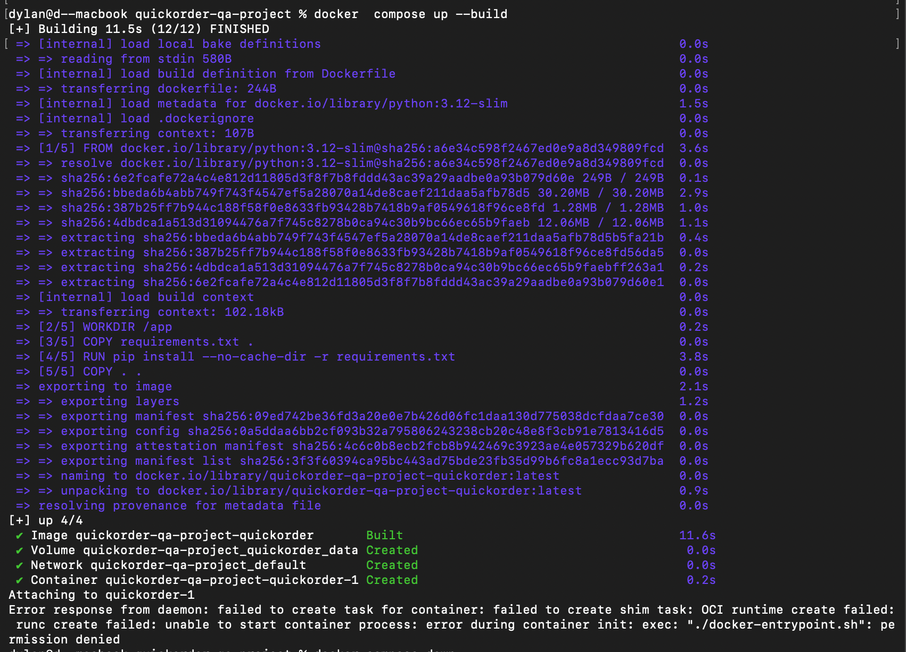

# BUG-01 — Le lancement via Docker Compose échoue : docker-entrypoint.sh non exécutable

Contexte (OS, navigateur, version, mode de lancement)

macOS, Docker Desktop, clone frais du repo

Cas de test lié

Aucun — anomalie d'installation constatée hors campagne

Préconditions

Docker Desktop démarré. Clone frais du repo QuickOrder V3.1 sur macOS.

Étapes de reproduction

git clone … → cd quickorder-qa-project → docker compose up --build

Résultat attendu

l’application démarre sur le port 5000, comme indiqué dans le README

Résultat obtenu

exec: "./docker-entrypoint.sh": permission denied

Preuve (fichier, requête / réponse)

Sévérité

☐ Critique   ☒ Majeure   ☐ Mineure   ☐ Cosmétique

Priorité

☒ Haute   ☐ Moyenne   ☐ Basse

Fréquence de reproduction

☒ Systématique   ☐ Intermittent

Contournement éventuel

chmod +x docker-entrypoint.sh puis rebuild
