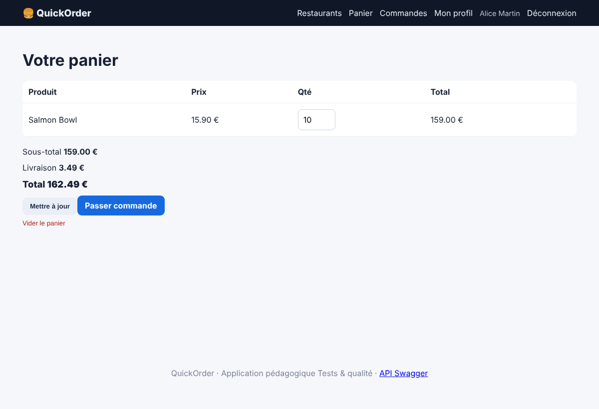
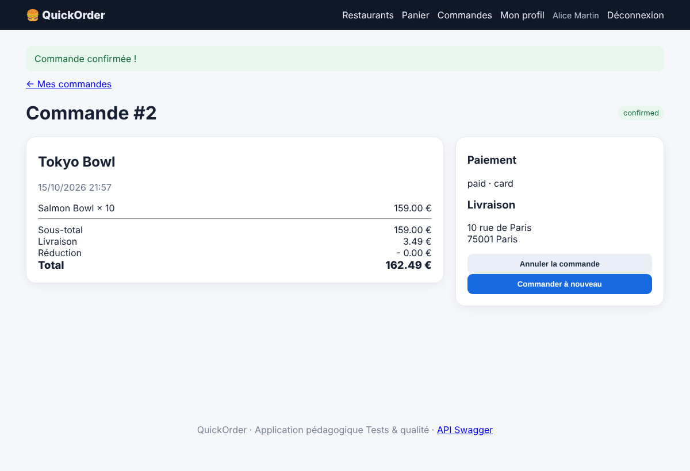

# BUG-03 — Une commande peut être passée avec une quantité supérieure au stock disponible

Contexte (OS, navigateur, version, mode de lancement)

Windows, Chrome, QuickOrder V3.1 lancé en local via Docker Compose (http://127.0.0.1:5000)

Cas de test lié

TC-LIM-01

Préconditions

Base réinitialisée (docker compose down -v puis docker compose up --build).  
Connecté avec alice@example.com / Password123!. Panier vide.  
Produit « Salmon Bowl » (restaurant Tokyo Bowl) : stock = 2.

Étapes de reproduction

1. Ouvrir le restaurant Tokyo Bowl.  
2. Sur « Salmon Bowl » (stock 2), saisir 10 dans le champ quantité.  
3. Cliquer « Ajouter », ouvrir le panier puis « Passer commande ».  
4. Garder l'adresse par défaut, paiement carte, cliquer « Confirmer ».

Résultat attendu

La quantité est refusée ou plafonnée au stock disponible (2), avec un message clair. La commande au-delà du stock est impossible.

Résultat obtenu

Le panier contient 10 Salmon Bowl (159,00 €) et la commande est confirmée, alors que le stock n'est que de 2.

Preuve (fichier, requête / réponse)

Captures prises sur QuickOrder V3.1 (même version, données de démo réinitialisées).  
Capture 1 — panier : 10 Salmon Bowl (stock 2)  
  
Capture 2 — commande confirmée  

Sévérité

☒ Critique   ☐ Majeure   ☐ Mineure   ☐ Cosmétique

Priorité

☒ Haute   ☐ Moyenne   ☐ Basse

Fréquence de reproduction

☒ Systématique   ☐ Intermittent

Contournement éventuel

Aucun côté client.
