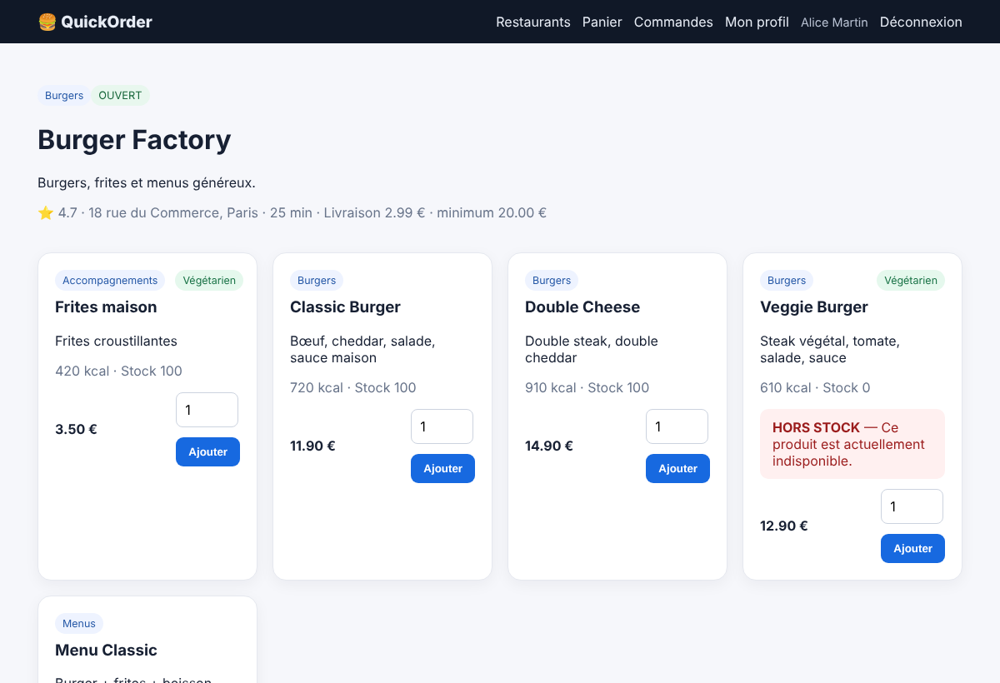
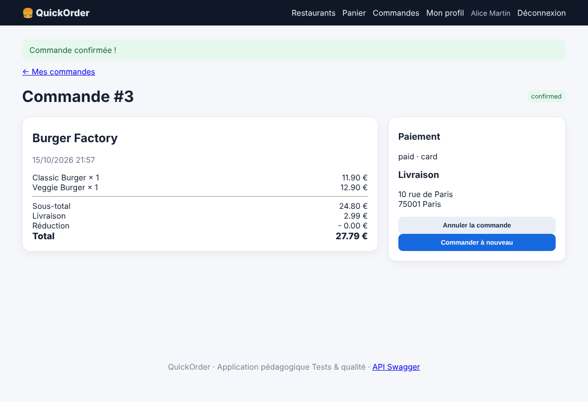

# BUG-04 — Un produit en rupture de stock (stock = 0) peut être ajouté au panier et commandé

Contexte (OS, navigateur, version, mode de lancement)

Windows, Chrome, QuickOrder V3.1 lancé en local via Docker Compose (http://127.0.0.1:5000)

Cas de test lié

TC-RM-01

Préconditions

Base réinitialisée (docker compose down -v puis docker compose up --build).  
Connecté avec alice@example.com / Password123!. Panier vide.  
Produit « Veggie Burger » (restaurant Burger Factory) : stock = 0.

Étapes de reproduction

1. Ouvrir le restaurant Burger Factory.  
2. Ajouter « Veggie Burger » au panier.  
3. Ajouter « Classic Burger » pour atteindre le minimum de commande (20 €).  
4. Aller au checkout et valider la commande.

Résultat attendu

Le bouton « Ajouter » est désactivé et l'ajout est refusé avec un message clair.

Résultat obtenu

Le produit affiche « HORS STOCK — indisponible », mais le bouton « Ajouter » reste actif : il s'ajoute au panier et la commande est confirmée.

Preuve (fichier, requête / réponse)

Captures prises sur QuickOrder V3.1 (même version, données de démo réinitialisées).  
Capture 1 — Veggie Burger « HORS STOCK » avec bouton « Ajouter » actif  
  
Capture 2 — commande confirmée avec Veggie Burger  

Sévérité

☒ Critique   ☐ Majeure   ☐ Mineure   ☐ Cosmétique

Priorité

☒ Haute   ☐ Moyenne   ☐ Basse

Fréquence de reproduction

☒ Systématique   ☐ Intermittent

Contournement éventuel

Aucun côté client.
