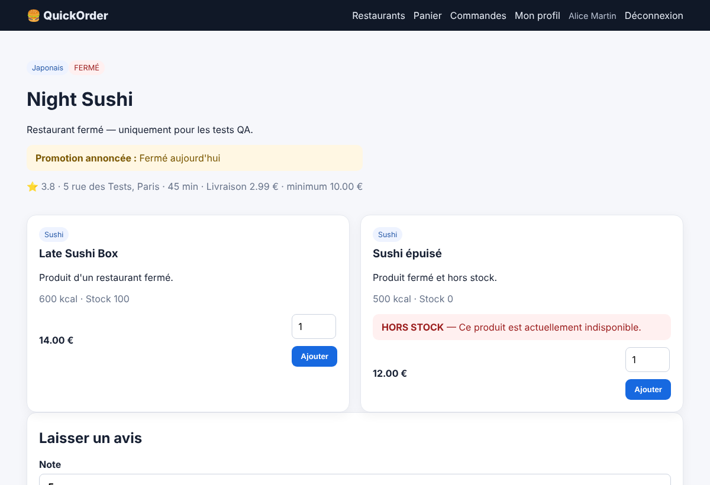
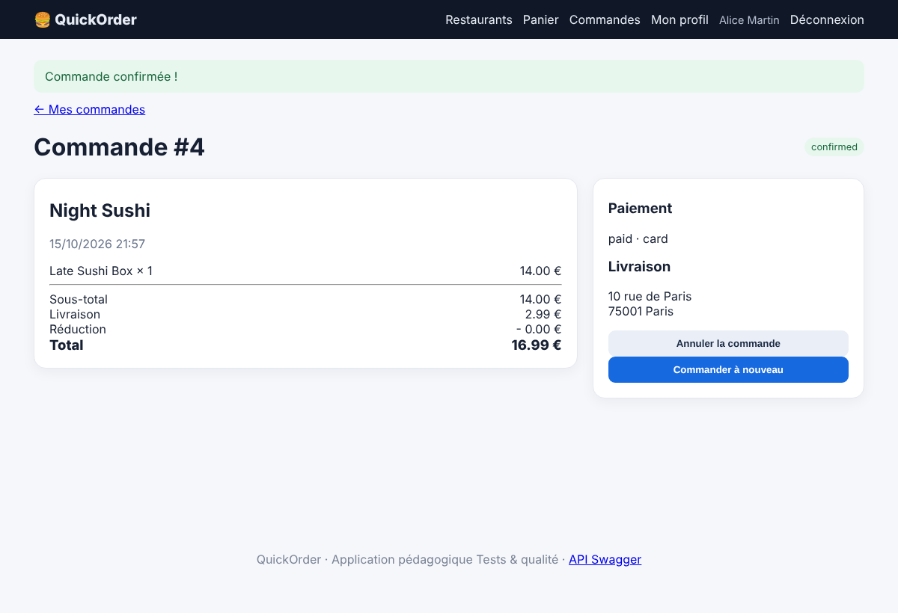

# BUG-05 — Une commande peut être passée dans un restaurant fermé

Contexte (OS, navigateur, version, mode de lancement)

Windows, Chrome, QuickOrder V3.1 lancé en local via Docker Compose (http://127.0.0.1:5000)

Cas de test lié

TC-RM-02

Préconditions

Base réinitialisée (docker compose down -v puis docker compose up --build).  
Connecté avec alice@example.com / Password123!. Panier vide.  
Restaurant « Night Sushi » marqué fermé (« Fermé aujourd'hui »).

Étapes de reproduction

1. Ouvrir le restaurant Night Sushi.  
2. Ajouter « Late Sushi Box » au panier.  
3. Aller au checkout et valider la commande.

Résultat attendu

La commande est impossible : boutons d'ajout désactivés ou message « Restaurant fermé » au panier et au checkout.

Résultat obtenu

La page affiche « FERMÉ », mais le produit s'ajoute au panier et la commande est confirmée (16,99 €).

Preuve (fichier, requête / réponse)

Captures prises sur QuickOrder V3.1 (même version, données de démo réinitialisées).  
Capture 1 — Night Sushi affiché « FERMÉ »  
  
Capture 2 — commande confirmée  

Sévérité

☒ Critique   ☐ Majeure   ☐ Mineure   ☐ Cosmétique

Priorité

☒ Haute   ☐ Moyenne   ☐ Basse

Fréquence de reproduction

☒ Systématique   ☐ Intermittent

Contournement éventuel

Aucun côté client.
