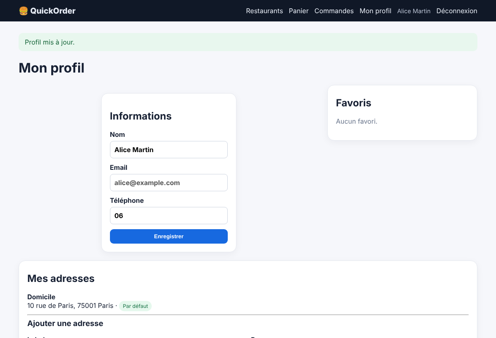

# BUG-06 — Le numéro de téléphone du profil accepte n'importe quel format (ex. « 06 »)

Contexte (OS, navigateur, version, mode de lancement)

Windows, Chrome, QuickOrder V3.1 lancé en local via Docker Compose (http://127.0.0.1:5000)

Cas de test lié

TC-ERR-01

Préconditions

Connecté avec alice@example.com / Password123!.

Étapes de reproduction

1. Ouvrir l'onglet « Mon profil ».  
2. Dans le champ Téléphone, saisir « 06 ».  
3. Cliquer sur « Enregistrer ».

Résultat attendu

L'enregistrement est refusé avec un message du type « Numéro de téléphone invalide » (format attendu : 10 chiffres commençant par 0, ou +33).

Résultat obtenu

Le message « Profil mis à jour. » s'affiche et le numéro « 06 » est enregistré. Aucun contrôle de format n'est fait.

Preuve (fichier, requête / réponse)

Captures prises sur QuickOrder V3.1 (même version, données de démo réinitialisées).  
Capture — « Profil mis à jour. » avec le téléphone « 06 »  

Sévérité

☐ Critique   ☐ Majeure   ☒ Mineure   ☐ Cosmétique

Priorité

☐ Haute   ☒ Moyenne   ☐ Basse

Fréquence de reproduction

☒ Systématique   ☐ Intermittent

Contournement éventuel

Aucun. Conséquence : le livreur peut ne pas pouvoir joindre le client.
