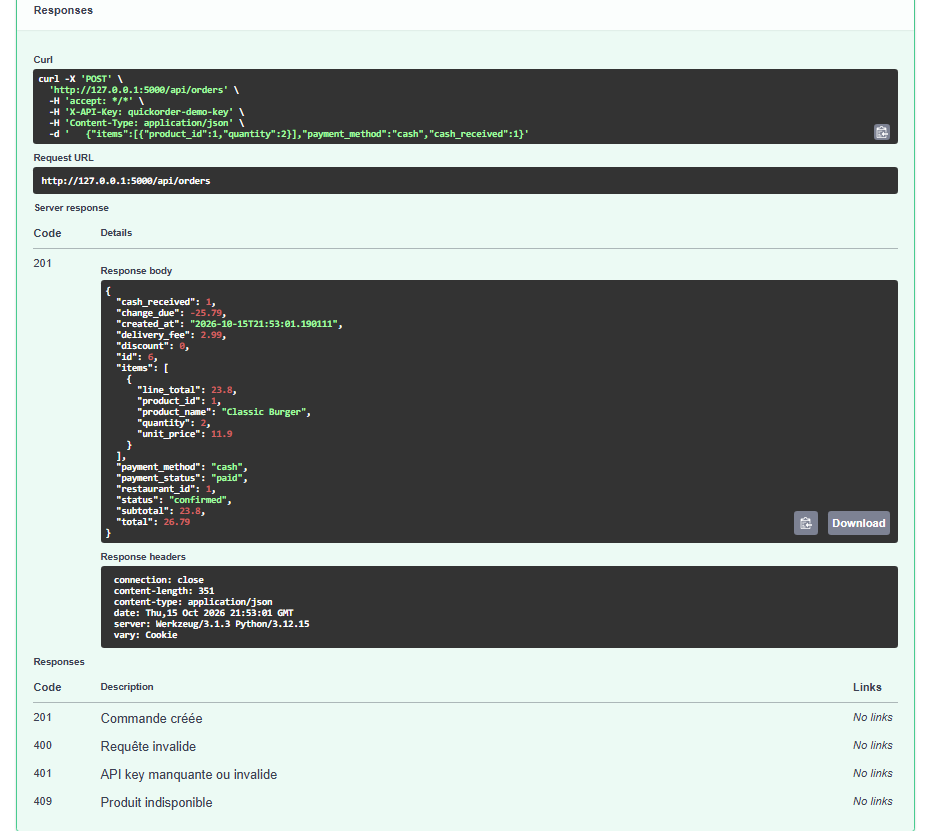

# BUG-07 — API POST /orders : un paiement en espèces avec un montant insuffisant est accepté et la commande est marquée payée

Contexte (OS, navigateur, version, mode de lancement)

Windows, Chrome, QuickOrder V3.1 lancé en local via Docker Compose. API testée dans Swagger (http://127.0.0.1:5000/docs/), clé X-API-Key = quickorder-demo-key (compte alice@example.com)

Cas de test lié

TC-RM-03

Préconditions

Base réinitialisée (docker compose down -v puis docker compose up --build). Swagger ouvert, bouton Authorize renseigné avec quickorder-demo-key.

Étapes de reproduction

1. Dans Swagger, ouvrir POST /orders puis « Try it out ».  
2. Envoyer le corps suivant (2 × Classic Burger, produit id 1) :  
{"items":[{"product_id":1,"quantity":2}],"payment_method":"cash","cash_received":1}  
3. Cliquer sur « Execute » et lire la réponse.

Résultat attendu

La commande est refusée (code HTTP 400) avec un message indiquant que le montant reçu (1 €) est inférieur au total à payer.

Résultat obtenu

Code HTTP 201 : la commande est créée.  
Réponse : "total": 26.79, "cash_received": 1.0, "change_due": -25.79, "payment_status": "paid", "status": "confirmed".  
La commande est considérée comme payée alors qu'il manque 25,79 €, et la monnaie à rendre est négative.

Preuve (fichier, requête / réponse)

Logs serveur : POST /api/orders → 201 (21:53:01). Commande id 6 créée.  
Capture — réponse HTTP 201 : "cash_received": 1, "change_due": -25.79, "payment_status": "paid", "total": 26.79  

Sévérité

☒ Critique   ☐ Majeure   ☐ Mineure   ☐ Cosmétique

Priorité

☒ Haute   ☐ Moyenne   ☐ Basse

Fréquence de reproduction

☒ Systématique   ☐ Intermittent

Contournement éventuel

Aucun : l'API ne contrôle pas le montant reçu.
