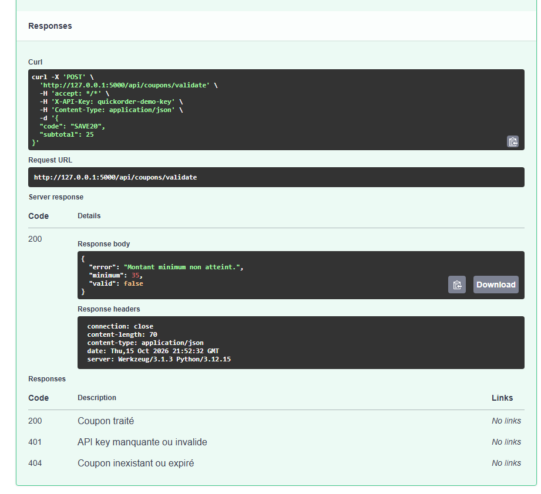
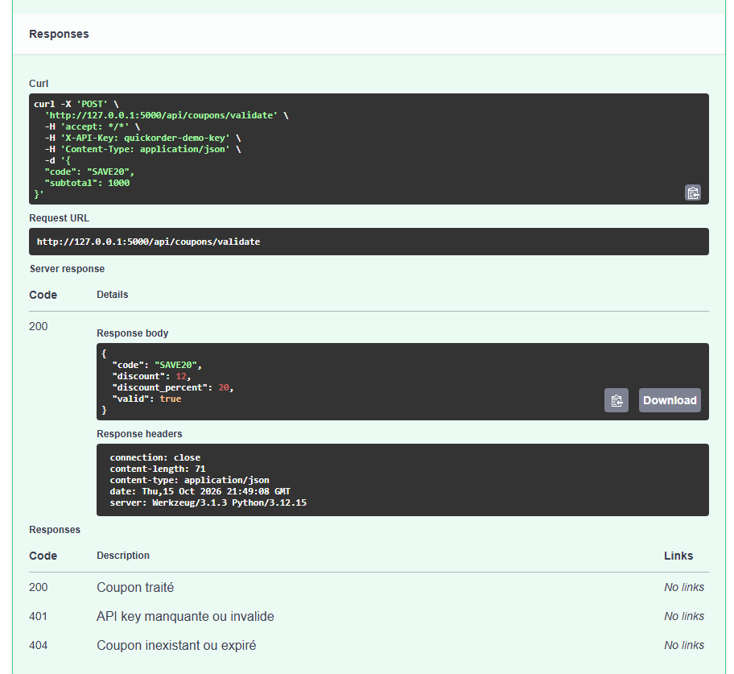

# BUG-08 — API POST /coupons/validate : le sous-total envoyé par le client n'est pas vérifié, un coupon peut être validé sans atteindre le minimum

Contexte (OS, navigateur, version, mode de lancement)

Windows, Chrome, QuickOrder V3.1 lancé en local via Docker Compose. API testée dans Swagger (http://127.0.0.1:5000/docs/), clé X-API-Key = quickorder-demo-key (compte alice@example.com)

Cas de test lié

TC-ERR-02

Préconditions

Base réinitialisée (docker compose down -v puis docker compose up --build). Swagger ouvert, bouton Authorize renseigné avec quickorder-demo-key. Coupon SAVE20 : -20 %, minimum de commande 35 €, plafond 12 €.

Étapes de reproduction

1. Dans Swagger, ouvrir POST /coupons/validate puis « Try it out ».  
2. Envoyer un sous-total réel inférieur au minimum :  
{"code":"SAVE20","subtotal":25}  
→ réponse : "valid": false, "Montant minimum non atteint." (comportement correct).  
3. Renvoyer la même requête en falsifiant le sous-total :  
{"code":"SAVE20","subtotal":1000}  
4. Cliquer sur « Execute » et lire la réponse.

Résultat attendu

Le serveur calcule lui-même le sous-total à partir du panier réel, ou refuse un sous-total qui ne correspond pas au panier. Le coupon reste refusé tant que le minimum de 35 € n'est pas atteint.

Résultat obtenu

Code HTTP 200, réponse : "valid": true, "discount": 12.0, "discount_percent": 20.0.  
L'API fait confiance à la valeur envoyée par le client : n'importe qui peut faire valider un coupon en modifiant le sous-total.

Preuve (fichier, requête / réponse)

Logs serveur : POST /api/coupons/validate → 200 (21:48:41, 21:49:08, 21:52:32).  
Capture 1 — sous-total réel = 25 : coupon refusé ("valid": false, « Montant minimum non atteint. »)  
  
Capture 2 — sous-total falsifié = 1000 : coupon validé ("valid": true, "discount": 12)  

Sévérité

☐ Critique   ☒ Majeure   ☐ Mineure   ☐ Cosmétique

Priorité

☒ Haute   ☐ Moyenne   ☐ Basse

Fréquence de reproduction

☒ Systématique   ☐ Intermittent

Contournement éventuel

Aucun côté serveur. Correction proposée : recalculer le sous-total côté serveur au lieu de le recevoir du client.
