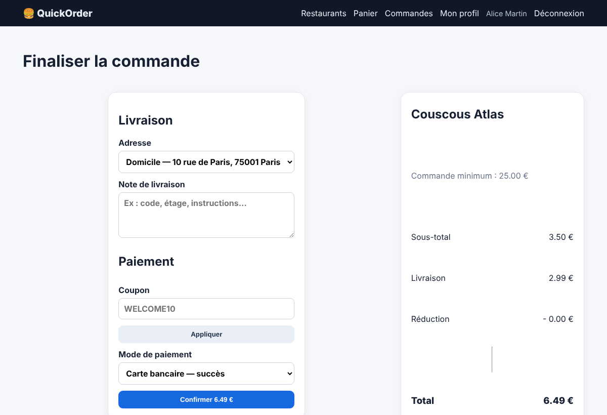
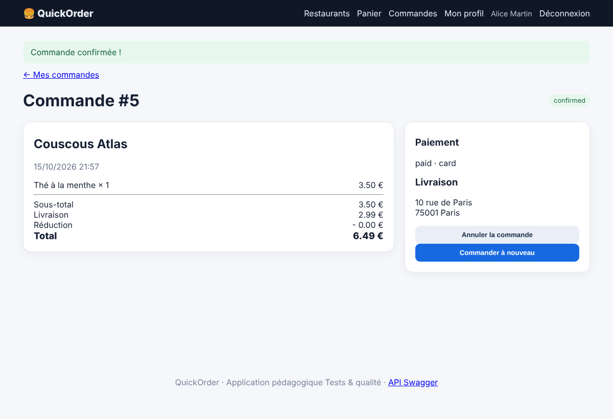

# BUG-09 — Le minimum de commande du restaurant n'est pas respecté

Contexte (OS, navigateur, version, mode de lancement)

Windows, Chrome, QuickOrder V3.1 lancé en local via Docker Compose (http://127.0.0.1:5000)

Cas de test lié

TC-LIM-05

Préconditions

Base réinitialisée (docker compose down -v puis up --build).  
Connecté en alice@example.com. Panier vide.  
Couscous Atlas : minimum de commande 25 €.

Étapes de reproduction

1. Ouvrir Couscous Atlas.  
2. Ajouter un « Thé à la menthe » (3,50 €).  
3. Aller au checkout et cliquer « Confirmer ».

Résultat attendu

La commande est refusée tant que le sous-total n'atteint pas 25 €.

Résultat obtenu

Le checkout affiche « Commande minimum : 25,00 € », mais la commande est confirmée pour 6,49 €.

Preuve (fichier, requête / réponse)

Captures prises sur QuickOrder V3.1 (même version, données de démo réinitialisées).  
Capture 1 — checkout : minimum 25 €, sous-total 3,50 €  
  
Capture 2 — commande confirmée à 6,49 €  

Sévérité

☐ Critique   ☒ Majeure   ☐ Mineure   ☐ Cosmétique

Priorité

☒ Haute   ☐ Moyenne   ☐ Basse

Fréquence de reproduction

☒ Systématique   ☐ Intermittent

Contournement éventuel

Aucun.
