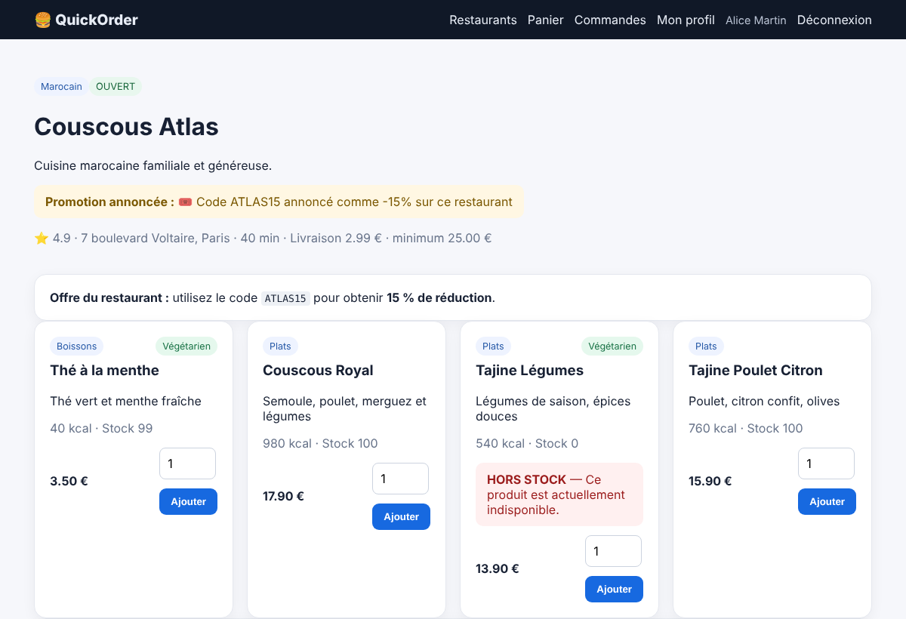
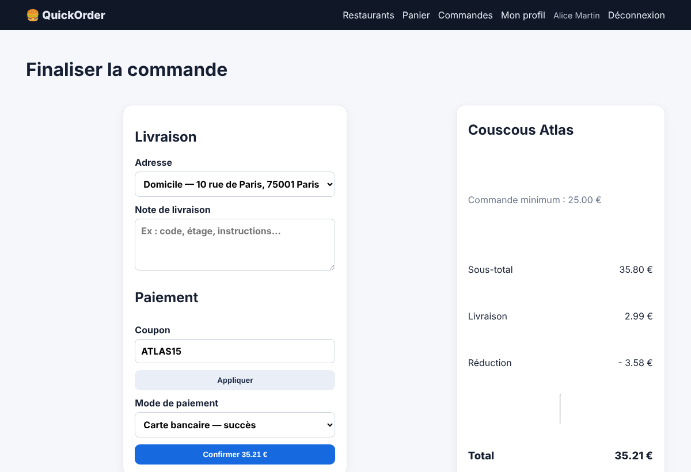

# BUG-10 — Le coupon ATLAS15 annoncé à -15 % n'applique que 10 %

Contexte (OS, navigateur, version, mode de lancement)

Windows, Chrome, QuickOrder V3.1 lancé en local via Docker Compose (http://127.0.0.1:5000)

Cas de test lié

TC-RM-06

Préconditions

Base réinitialisée (docker compose down -v puis up --build).  
Connecté en alice@example.com. Panier vide.

Étapes de reproduction

1. Ouvrir Couscous Atlas (annonce « 15 % de réduction » avec ATLAS15).  
2. Ajouter 2 « Couscous Royal » (35,80 €).  
3. Au checkout, saisir ATLAS15 et cliquer « Appliquer ».

Résultat attendu

Réduction de 15 %, soit 5,37 €.

Résultat obtenu

Réduction de 3,58 € (10 %), total 35,21 €. La promotion affichée n'est pas tenue.

Preuve (fichier, requête / réponse)

Captures prises sur QuickOrder V3.1 (même version, données de démo réinitialisées).  
Capture 1 — annonce « 15 % de réduction »  
  
Capture 2 — réduction appliquée : 3,58 € (10 %)  

Sévérité

☐ Critique   ☒ Majeure   ☐ Mineure   ☐ Cosmétique

Priorité

☐ Haute   ☒ Moyenne   ☐ Basse

Fréquence de reproduction

☒ Systématique   ☐ Intermittent

Contournement éventuel

Aucun.
